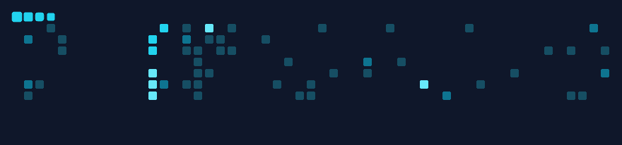

<!-- GitHub profile README | 51 technologies from the provided PDF (50 numbered + Python). -->
<!-- All technologies are presented as a learning/building roadmap, not a proficiency certification. -->

<a href="#-about-me">About</a> • <a href="#-animated-skill-universe">Animated Skills</a> • <a href="#-complete-technology-stack">Full Stack</a> • <a href="#-github-dashboard">Dashboard</a> • <a href="#-contribution-snake">Snake</a> • <a href="#-connect">Connect</a>

---

## 👨‍💻 About Me

<table><tr><td valign="top" width="68%">

<ul><li>🎓 Computer Science student at <b>Aryan Institute of Engineering &amp; Technology, Bhubaneswar</b>.</li>
<li>🧠 Focused on <b>AI engineering, Java/Spring Boot, full-stack development, and real-time systems</b>.</li>
<li>🤖 Exploring <b>robotics, cybersecurity visualization, and intelligent automation</b>.</li>
<li>🌍 Interested in <b>distributed systems, cloud-native architecture, and global data visualization</b>.</li>
<li>🤝 Open to learning, collaboration, and building practical projects.</li></ul>

</td><td align="center" width="32%">

</td></tr></table>

### 🚀 Projects and Ideas

- **AI engineering platforms** — intelligent web applications and AI workflows.
- **Cyber attack visualization globe** — security-focused real-time visualization.
- **Flight tracking system** — live location and telemetry dashboards.
- **Web2 e-learning platform** — modern and accessible learning experiences.
- **Robotics research projects** — automation and intelligent control systems.

> **Current direction:** build a strong foundation across the 51 technologies listed in my learning roadmap.

---

## 🌌 Animated Skill Universe

---

## 🧰 Complete Technology Stack

**51 named technologies** taken from my roadmap PDF: 50 numbered entries plus Python. These represent technologies I am studying, using, or planning to explore—not a claim of expert-level proficiency in every one.

### Frontend & UI · 5

### Programming Languages · 2

### Backend, APIs & Databases · 13

### Event-Driven Systems · 2

### Generative AI & Agents · 9

### DevOps, Cloud & Hosting · 10

### Testing & Code Quality · 4

### Monitoring & Observability · 6

Note: The PDF also lists “Java M” and “Java C” as unnumbered Java study rows; I kept them under Java rather than assigning them unrelated technology names.

---

## 📊 GitHub Dashboard

---

## 🐍 Contribution Snake

<picture>
  <source media="(prefers-color-scheme: dark)" srcset="https://raw.githubusercontent.com/rashmiranjanaiet/rashmiranjanaiet/output/github-contribution-grid-snake-dark.svg"/>
  <source media="(prefers-color-scheme: light)" srcset="https://raw.githubusercontent.com/rashmiranjanaiet/rashmiranjanaiet/output/github-contribution-grid-snake.svg"/>
  
</picture>

The snake is generated by `.github/workflows/snake.yml`. The animation appears after the workflow completes and publishes the `output` branch.

---

## 🤝 Connect

